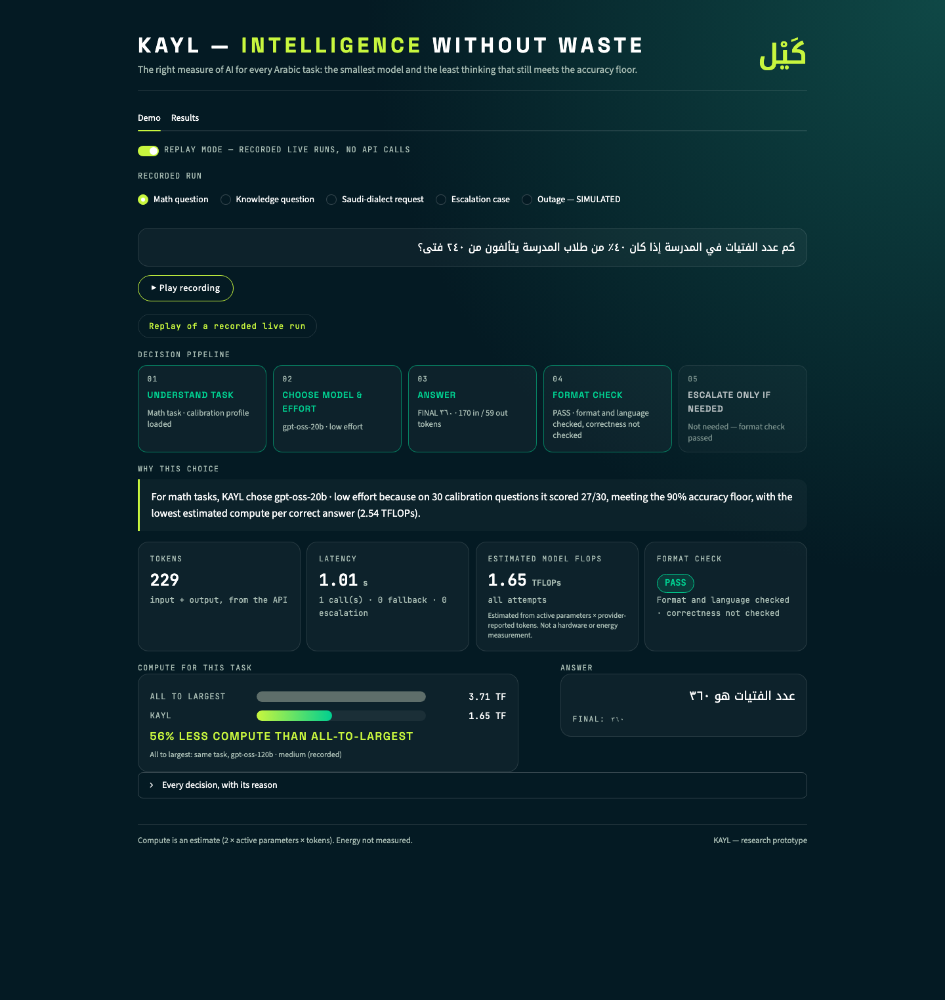
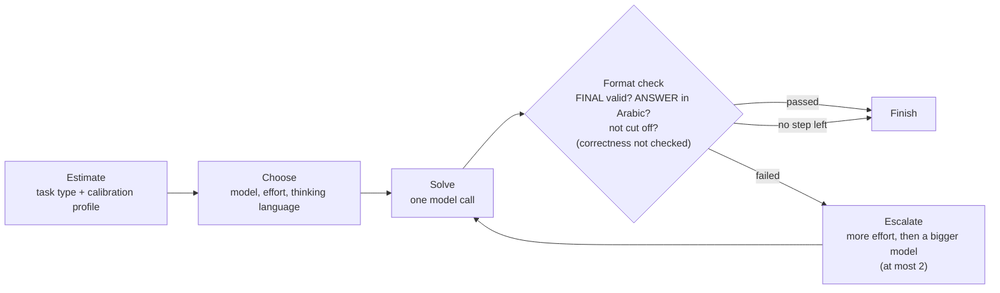

# KAYL — كَيْل

**Intelligence Without Waste. The right measure of AI for every Arabic task.**

[](requirements.txt)
[](tests/)

KAYL reduced estimated compute per correct answer by 49%, with 79/90 correct versus 83/90 for the largest-model baseline, and met its accuracy floor in 1 of 3 task types.



KAYL is an agent that answers Arabic tasks with the least compute that still meets an accuracy floor.
It does not train any model: it only uses controls that already exist.

## The problem

- The usual default is to send every request to the largest model with plenty of thinking. Much of that compute buys no extra accuracy.
- On our Arabic math calibration set, `gpt-oss-120b` at high effort and `gpt-oss-20b` at low effort both scored **27/30 (90%)**.
- The first needed **8.92 TFLOPs** per correct answer and the second **2.54 TFLOPs**: about **3.5× the compute for the same accuracy**.

## How KAYL works



For each task, KAYL picks three keys:
- **Model:** `allam-2-7b`, `gpt-oss-20b` or `gpt-oss-120b`, all on Groq.
- **Reasoning effort:** low, medium or high (gpt-oss only).
- **Thinking language:** Arabic or English. The answer is always in Arabic.

**Selection rule:** among the configurations that met the accuracy and latency floors for this task type on calibration data, KAYL picks the one with the lowest estimated compute per correct answer, and breaks ties by latency.
- If a model hits a limit or is unavailable, KAYL falls back to the next-best model.
- Every decision is stored with a short human-readable reason, which the demo UI shows.

**Metric:** estimated compute per successful task = Σ 2 × active parameters × (input + output tokens) over *all* calls, including failures, ÷ number correct. It is an estimate based on the token counts the API returned; energy is not measured.

## Results

**KAYL reduced estimated compute per correct answer by 49%, with 79/90 correct versus 83/90 for the largest-model baseline, and met its accuracy floor in 1 of 3 task types.** Held-out test: 90 questions (30 math, 30 knowledge, 30 intent), one run at temperature 0.

| Experiment | Correct | Compute / success (TFLOPs, est.) | Cost / success | Types meeting the floors |
|---|---|---|---|---|
| **D — KAYL** | 79/90 (88%) | **2.56** | **$0.000050** | 1/3 |
| A — all to largest (120b-medium) | **83/90 (92%)** | 5.02 | $0.000188 | 3/3 |
| B — fewest tokens (allam-2-7b) | 62/90 (69%) | 6.83 | n/a | 2/3 |
| C — cheapest price (20b-medium) | 77/90 (86%) | 5.65 | $0.000178 | 2/3 |
| E — question-length proxy | 82/90 (91%) | 5.35 | $0.000189 | 3/3 |
| *Ablation:* D minus model key (120b-low) | 80/90 (89%) | 3.47 | $0.000093 | 3/3 |

**Per task type** (correct/30; the floor is baseline A's calibration score minus one question):

| | math | knowledge | intent |
|---|---|---|---|
| Floor | ≥ 27/30 | ≥ 19/30 | ≥ 28/30 |
| D — KAYL | 25/30 ✗ | 27/30 ✓ | 27/30 ✗ |
| A — all to largest | 29/30 ✓ | 25/30 ✓ | 29/30 ✓ |

- KAYL met its own floor on knowledge, but missed math by 2 questions and intent by 1.
- Its choices were made on calibration data only and were **not** changed after the test.
- The 120b-low ablation met all three floors with about 31% less compute than A. This is an observation on the test set, not a choice.

Full tables, all ablations, robustness scenarios and the calibration sweep are in **[RESULTS.md](RESULTS.md)**.

## Key findings

- **Fewest tokens ≠ least compute.** ALLaM is the "fewest tokens" baseline (B), but it needed 6.83 TFLOPs per correct answer, more than A (5.02).
  - It is a 7B dense model, so each token costs more compute than in gpt-oss-20b (3.6B active parameters).
  - It scored only 12/30 on math.
  - Counting tokens alone hides what each token costs.
- **Thinking in Arabic was ignored (negative result).** Asked to reason in Arabic, gpt-oss-20b reasoned in English in **32 of 32** calls. That configuration was stopped, so the thinking-language key had no effect in this setup.
- **Error analysis:** among KAYL's 11 wrong answers there were **0 arithmetic slips** and 0 format issues.
  - **3 of the 11 trace back to the data:** two Arabic-GSM8K translation problems and one intent row that the human review had flagged as ambiguous.
  - Every wrong answer passed the format check, because it checks format and language, not correctness.

## Quick start

Requires Python (tested on 3.14).

**Reproduce every result from the cache: no API key, no API calls.**

```bash
python3 -m venv .venv && source .venv/bin/activate && pip install -r requirements.txt
pytest                                                  # 329 tests, including a replay of recorded test answers
python -m scripts.run_final --final-eval --from-cache   # the final test table
```

All the other runs replay the same way, from the repository root:

```bash
python -m scripts.prepare_data                                  # rebuilds data/ exactly (no model calls)
python -m scripts.run_sweep --from-cache --route groq           # calibration sweep
python -m scripts.run_fallback_drill --from-cache --route groq  # real-condition fallback drill
python -m scripts.run_simulated_outage --from-cache             # SIMULATED outage
```

- `--from-cache` stops at the first response that was not recorded.
- No script writes to `results/` if any call failed.
- `prepare_data` and the two drills download the public datasets from Hugging Face on first use.

**Run live with your own key:**

```bash
cp .env.example .env    # add GROQ_API_KEY (and OPENROUTER_API_KEY for the final-test route)
python -m scripts.run_final --final-eval   # drop --from-cache; new responses are added to the cache
```

**Open the demo UI:**

```bash
streamlit run app.py    # Replay mode plays recorded runs with no API calls; Live mode needs a key
```

## Repository structure

```text
kayl/           the agent: client, cache, prompts, parsing, grading, metrics, calibration profile, SQLite log
scripts/        data build, intent generation, calibration sweep, final test, robustness runs
tests/          pytest tests (no API calls)
data/           calibration, held-out test and robustness splits; synthetic intent source and review
results/        every reported result (the local SQLite call log is not committed)
cache/llm/      every raw model response, keyed by model + params + prompt hash
docs/           demo UI screenshots
app.py          Streamlit demo UI
config.yaml     models, prices, floors, routing and limits: the single source of truth
```

## Limitations

- **Small samples:** 30 questions per type, so one question is 3.3 points.
- **One run** at temperature 0. Run-to-run variance was not measured.
- **The verifier checks format, not correctness**, so escalation never triggered on the test set.
- **Compute is an estimate** from active parameters and API token counts, not a hardware measurement.
- **ALLaM's price is unknown** (Groq lists it as "Pending"), so dollar cost is n/a wherever it is used.
- **The intent data is synthetic.** An AI model generated it, and one reviewer checked all 80 rows by hand.
- **Not run:** the noisy-input, price-change, stricter-floor and English-input scenarios.

## Next steps

- Give the verifier a cheap correctness signal. Examples: escalate when two low-effort answers disagree, or when the ANSWER line only repeats the question.
- Define `other` more clearly in the intent prompt.
- Use a bigger calibration set, or a safety margin above the floor, so choices sitting exactly on a floor are more robust.
- Run the remaining robustness scenarios and a second run.

These ideas are untested.

## Data and licenses

The datasets keep their own licenses:
- **math:** [Arabic-GSM8K](https://huggingface.co/datasets/Omartificial-Intelligence-Space/Arabic-gsm8k), MIT.
- **knowledge:** [ArabicMMLU](https://huggingface.co/datasets/MBZUAI/ArabicMMLU), CC-BY-NC-4.0 (non-commercial).
- **intent:** synthetic messages in MSA and Saudi dialect. `qwen/qwen3.8-27b` generated them; it is not one of KAYL's candidate models. All 80 rows were reviewed by hand: 72 ok, 5 not natural, 3 ambiguous.
- **robustness:** [GSM8K](https://huggingface.co/datasets/openai/gsm8k) (English), MIT.

Sources, revisions, build steps and data limitations are in [DATA.md](DATA.md).

## References

- Ong et al., *RouteLLM: Learning to Route LLMs with Preference Data*, ICLR 2025. [arXiv:2406.18665](https://arxiv.org/abs/2406.18665)
- Ding et al., *BEST-Route: Adaptive LLM Routing with Test-Time Optimal Compute*, ICML 2025. [arXiv:2506.22716](https://arxiv.org/abs/2506.22716)
- Kleinman et al., *e1: Learning Adaptive Control of Reasoning Effort*, 2025. [arXiv:2510.27042](https://arxiv.org/abs/2510.27042)
- Li et al., *SelfBudgeter: Adaptive Token Allocation for Efficient LLM Reasoning*, 2025. [arXiv:2505.11274](https://arxiv.org/abs/2505.11274)
- Ahuja et al., *EfficientXLang: Towards Improving Token Efficiency Through Cross-Lingual Reasoning*, Findings of EMNLP 2025. [arXiv:2507.00246](https://arxiv.org/abs/2507.00246)
- Petrov et al., *Language Model Tokenizers Introduce Unfairness Between Languages*, NeurIPS 2023. [arXiv:2305.15425](https://arxiv.org/abs/2305.15425)

KAYL's baseline E is a simple question-length proxy, not an implementation of any of these routers.
